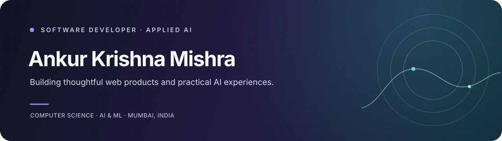

 

### B.E. Computer Science (AI & ML) · VIVA Institute of Technology

**I build useful web products and practical AI experiences.**

Mumbai, India · Open to software development internships and interesting collaborations

---

## About me

I'm a computer science student focused on the intersection of **web engineering and applied AI**. I enjoy taking a real-world problem, shaping it into a useful product, and building an experience that feels just as thoughtful as the idea behind it.

- 🎓 Studying Computer Science (AI & ML) at VIVA Institute of Technology
- 🧠 Exploring natural language processing, machine learning, and computer vision
- 🛠️ Building web applications, experiments, and tools that solve practical problems
- 🤝 Interested in software development internships and collaborating on meaningful projects

## Selected work

<table>
<tr>
<td width="50%" valign="top">

### 🏛️ RTI Black Hole

**Helping people find the right path for an RTI query.**

An AI-assisted civic-tech platform that analyzes a query, recommends a government department, and includes human review when a request is ambiguous.

`React` · `TypeScript` · `FastAPI` · `NLP`

[Explore the project →](https://github.com/immishra13/RTI-black-hole)

</td>
<td width="50%" valign="top">

### 🧾 Financial Complaint Intelligence

**Making complaint analysis easier to understand.**

A local academic prototype that classifies complaint narratives with a five-class TF-IDF and Logistic Regression model, with visible NLP steps and model evidence.

`Python` · `scikit-learn` · `TF-IDF` · `NLTK`

[Explore the project →](https://github.com/immishra13/-Financial-Complaint-Classifier)

</td>
</tr>
<tr>
<td width="50%" valign="top">

### ✋ SignSight

**Real-time sign-language recognition on the web.**

A collaborative project recognizing ASL alphabet gestures and commonly used words, bringing computer vision into an interactive web experience.

`React` · `Redux` · `MediaPipe` · `Firebase`

[Explore the project →](https://github.com/immishra13/signsight-frontend)

</td>
<td width="50%" valign="top">

### 💡 What I enjoy building

Clean, approachable interfaces backed by useful functionality—whether that's an AI-assisted tool, a web app, or a small product that makes someone's day easier.

Always learning. Always building.

</td>
</tr>
</table>

## Tools I work with

---

*Curious about an idea or want to build something useful together?*

**[Say hello on LinkedIn](https://www.linkedin.com/in/ankur-krishna-mishra-923654235/) · [See what I'm building](https://github.com/immishra13?tab=repositories)**

